# app#40 — purchase details: emulated-iPhone evidence at `3072da3`

**20/20 checks passed** · run 2026-10-19T14:40:09.344Z

Review evidence only. This branch holds no product code and is not meant to be merged. Everything in it is synthetic: companies, invoices, photos, and the ids of a local, disposable database.

**Setup**

- **App:** `3072da318cebbcf61d4a9f4212b30d828068dc1d`, a production build (`next build --webpack`)
- **Database:** PostgreSQL 18.4 with 50 login migrations applied (latest journal time 1790003300000), built by rebuild-db.sh from login 631c28f + seed; app connects as portal_app (RLS)
- **Media store:** stand-in, S3-strict: a body without Content-Length is refused (411 MissingContentLength), as S3 does
- **Browser:** Chromium 141 with Playwright's `iPhone 13` descriptor (390×664, DPR 3, touch, iOS Safari user agent)
- **Limits:** Desktop Chromium emulating an iPhone viewport and user agent. Not WebKit, not iOS: Safari's file picker, its PDF viewer and HEIC decoding are not exercised. Media store and Ollama server are local stand-ins (fake-services.mjs). Every company, invoice and photo is synthetic.

**Files**

- `results.json`: every check, with its detail.
- `screens/`: the screenshots, each the full page at phone width.

## Purchase details on the container page

- **PASS P1**: a container with nothing recorded says “Not recorded” for seller, date, price and invoice; the form is folded away
  - Detail: `{"Bought from":"Not recorded","Bought on":"Not recorded","Price paid":"Not recorded","Invoice or receipt":"Not recorded","Last bought":"Not recorded","Next time, buy from":"No preferred seller"}`

  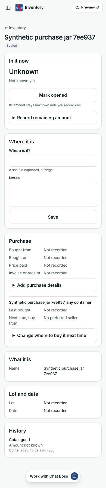
- **PASS P2**: a PDF sent from the form is listed (PDF, its size) and chosen at once, before saving
  - Detail: `5a8827e9-05b9-47fe-9d19-ea3e82b6101f`

  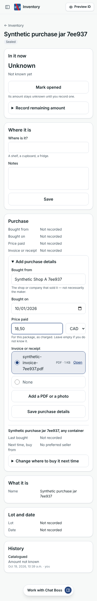
- **PASS P3**: saved: “Purchase details saved.”; the card shows the new seller with its own 10XiD iD, the date, CAD 18.50 and the invoice
  - Detail: `{"Bought from":"Synthetic Shop A 7ee937 iD 10X-TKYS9","Bought on":"Oct 1, 2026","Price paid":"CAD 18.50","Invoice or receipt":"synthetic-invoice-7ee937.pdf","Last bought":"Oct 1, 2026, from Synthetic Shop A 7ee937, CAD 18.50 — this container","Next time, buy from":"No preferred seller"}`

  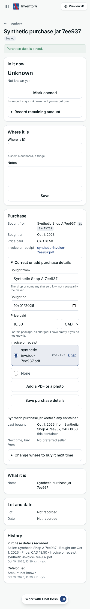
- **PASS P4**: clearing the seller saves it as not known — a new record superseding the first, which is kept — and History lists both versions, the correction as “Seller cleared (was …)”
  - Detail: `{"cleared":{"Bought from":"Not recorded","Bought on":"Oct 1, 2026","Price paid":"CAD 18.50","Invoice or receipt":"synthetic-invoice-7ee937.pdf","Last bought":"Oct 1, 2026, seller not recorded, CAD 18.50 — this container","Next time, buy from":"No preferred seller"},"historyText":["Purchase details corrected","Purchase details recorded","Catalogued"],"historyDetails":["Seller cleared (was Synthetic…`

  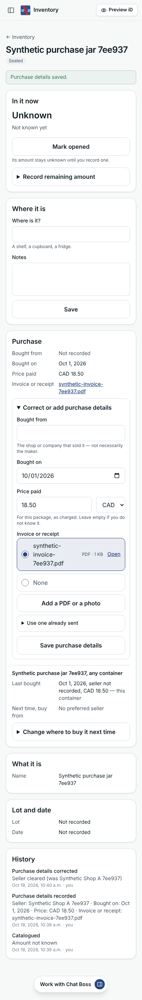
- **PASS P5**: a page opened before another phone's save is refused (“…changed after this page was opened…”), keeps what was typed, and saves nothing over it
  - Detail: `["18.50","18.50","19.00"]`

  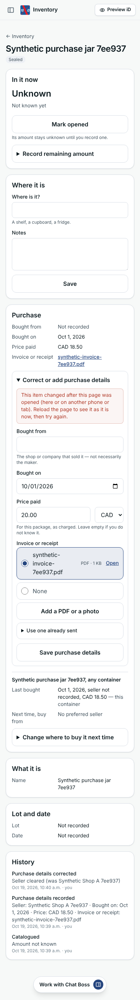
- **PASS P6**: a price that is not a number, or a date after today, is refused beside its field; nothing is saved

## Invoice or receipt: upload, reuse, download, privacy

- **PASS D1**: the invoice opens as the same PDF, privately: application/pdf, nosniff, private no-store, inline under its name
  - Detail: `200 application/pdf | inline; filename="synthetic-invoice-7ee937.pdf"; filename*=UTF-8''synthetic-invoice-7ee937.pdf | 448 bytes`
- **PASS D2**: kept in the private store under inventory/<business>/ as an invoice, linked to this container as purchase paperwork and to no capture
  - Detail: `{"kind":"invoice","content_type":"application/pdf","storage_key":"inventory/fde60ca1-6c44-443a-a63a-6cbd95cba3e2/OK14sOvAWO09xluCDxaGQyrGq5zmb1NU.pdf","capture_id":null,"links":[{"container_id":"34dfe61f-86bd-4e99-99ce-b8953fa31f07","capture_id":null,"role":"purchase"}]}`
- **PASS D3**: without a session the invoice is not served
  - Detail: `status 401`
- **PASS D4**: one invoice for two jars: offered under “Use one already sent”, cited by both records, still one document, attached to both
  - Detail: `{"r2":[{"id":"76272685-47dc-4c4e-802a-9b1052e1d498","supersedes_id":null,"vendor_id":"7d1a07bd-821c-4656-a2c3-d9207588f2aa","acquired_on":null,"price":"21.00","currency":"USD","document_id":"5a8827e9-05b9-47fe-9d19-ea3e82b6101f"}],"both":["34dfe61f-86bd-4e99-99ce-b8953fa31f07","52811206-1445-4103-be02-3ad2cebe50f0"]}`

  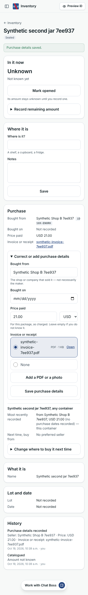
- **PASS D5**: a receipt photo is redrawn on the phone (upright, no EXIF, so no location) and kept as paperwork — never in the label photo strip, nor is the PDF
  - Detail: `{"jpeg":true,"height":800,"width":400,"exif":false,"strip":0,"stripPdf":0}`

  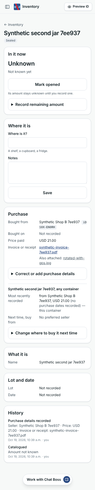

## Edits one after another, without reloading

- **PASS E1**: refused (typing kept), then corrected (“23”, the seller in capitals) and saved without reloading: the form opened again shows the record as saved — 23.00, the seller's own name — with no leftover error and the current version
  - Detail: `{"vendor":"Synthetic Shop B 7ee937","price":"23.00","currency":"USD","acquiredOn":"","documentId":"5a8827e9-05b9-47fe-9d19-ea3e82b6101f","chosen":1,"errors":[],"version":"1a9bc969-5c94-4dc0-918c-15c3c1b52ed2"}`

  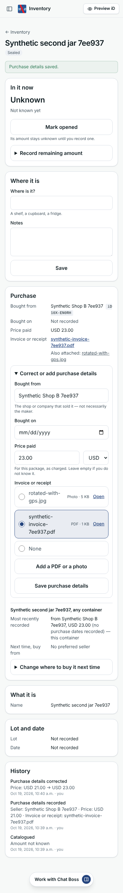
- **PASS E2**: a second correction from the same form saves too, on top of the first
  - Detail: `{"id":"58941a4f-34be-48bc-9ada-29a3d8de491b","supersedes_id":"1a9bc969-5c94-4dc0-918c-15c3c1b52ed2","vendor_id":"7d1a07bd-821c-4656-a2c3-d9207588f2aa","acquired_on":null,"price":"24.00","currency":"USD","document_id":"5a8827e9-05b9-47fe-9d19-ea3e82b6101f"}`
- **PASS E3**: clearing the invoice saves “not recorded”; the form opened again has None chosen and nothing sent as the invoice
  - Detail: `{"vendor":"Synthetic Shop B 7ee937","price":"24.00","currency":"USD","acquiredOn":"","documentId":"","chosen":2,"errors":[],"version":"0e4bb848-b4f9-4968-b35a-6778cf03d414"}`

  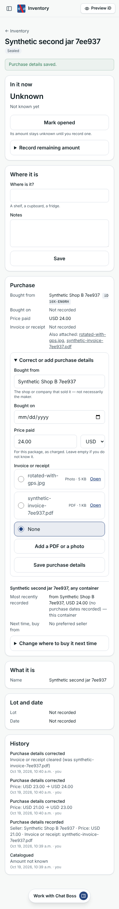
- **PASS E4**: choosing the invoice again saves it; the form opened again has it chosen, at the current version
  - Detail: `{"vendor":"Synthetic Shop B 7ee937","price":"24.00","currency":"USD","acquiredOn":"","documentId":"5a8827e9-05b9-47fe-9d19-ea3e82b6101f","chosen":1,"errors":[],"version":"8b2646d8-0c6a-4a54-81ca-76d2b6cbdfe9"}`

  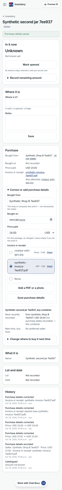

## Preferred seller and the product's last purchase

- **PASS V1**: “Next time, buy from” is set on its own, and a later purchase save leaves it as it is
  - Detail: `{"before":"Synthetic Shop A 7ee937","after":"Synthetic Shop A 7ee937"}`

  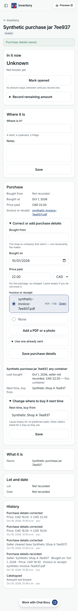
- **PASS V2**: the product's last purchase is this one, by its date, and says the seller is not recorded (it was cleared)
  - Detail: `["Last bought","Oct 1, 2026, seller not recorded, CAD 22.00 — this container"]`

## Nothing else changes: stock, label reader, photo strip

- **PASS N1**: the stock of both jars is exactly as before: the same events, the same balance
  - Detail: `[{"movements":1,"balance":{"balance":null,"balance_basis":"unknown"}},{"movements":1,"balance":{"balance":null,"balance_basis":"unknown"}}]`
- **PASS N2**: nothing was sent to the label reader while paperwork was added
  - Detail: `readings 0 → 0`

## Browser console

- **PASS C1**: no errors in any phone's browser console

## Other screenshots

- **Second jar: the invoice already sent is offered**

  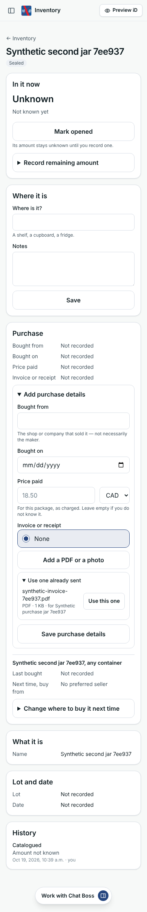

- **A price that is not a number: refused beside the field**

  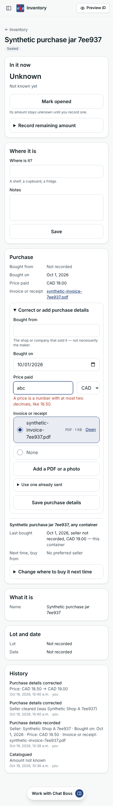

