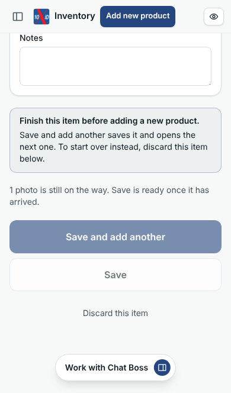
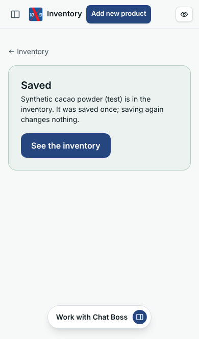
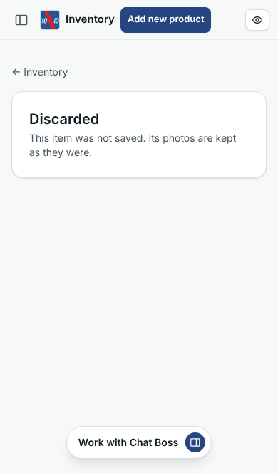
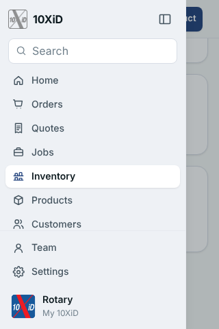

# app#41 · Add new product in the top bar — emulated iPhone evidence

**47/47 checks passed** · app `c88283f` (production build `gJ5vR35VH3A4_ldgheP2b`, `next build --webpack`) · 2026-10-20T02:50:24.253Z

- Browser: Chromium 141.0.7390.37 (Playwright `devices["iPhone 13"]`: 390×664 CSS px, DPR 3, touch, iOS Safari user agent), and the same descriptor at 375×548, 360×640 and 320×480. **Desktop emulation, not Safari on an iPhone**: no real iOS keyboard, toolbar or safe area.
- Scrolling: a finger dragged over `main` (CDP `Input.dispatchTouchEvent`), repeated until it stops moving.
- Database: PostgreSQL 18.4 with 50 login migrations applied, built by rebuild-db.sh from login 631c28f + seed; app connects as portal_app (RLS). Media store and label reader are local stand-ins. Owner, business and photos are synthetic.
- Offline on purpose (Q1–U5): the browser logged 5 failed request(s) while offline, listed in results.json and not counted as errors.

| | Check | Detail |
|---|---|---|
| ✅ H1 | 390 px, inventory list: Add new product immediately right of Inventory, one line, nothing cut off or off the screen | title 92–161, Add new product 169–296.5 (8px after the title), Preview iD 344–378, icon only, mark shown, overflow 0/0 |
| ✅ H2 | 390 px: Preview iD keeps its icon, and its name for screen readers | title 92–161, Add new product 169–296.5 (8px after the title), Preview iD 344–378, icon only, mark shown, overflow 0/0 |
| ✅ H3 | The page asks for no full-bleed layout: Safari keeps it inside the safe area | viewport meta "width=device-width, initial-scale=1" |
| ✅ S1 | From the list, Add new product opens the start page; 4 taps and a plain GET make no item | items 0 before, 0 after; GET /inventory/capture 200 |
| ✅ H4 | 390 px, start page: Add new product immediately right of Inventory, one line, nothing cut off or off the screen | title 92–161, Add new product 169–296.5 (8px after the title), Preview iD 344–378, icon only, mark shown, overflow 0/0 |
| ✅ S2 | Start (the existing button) makes one item and opens its camera |  |
| ✅ Q1 | Offline, a fourth photo waits on the phone (IndexedDB) and Save waits for it; everything typed is in the form | name "Synthetic cacao powder (test)", brand "Synthetic Co.", open / estimate 120, label 250 g, lot SYN-0001, photos 3 sent + 1 waiting, browser offline |
| ✅ H5 | 390 px, item being catalogued: Add new product immediately right of Inventory, one line, nothing cut off or off the screen | title 92–161, Add new product 169–296.5 (8px after the title), Preview iD 344–378, icon only, mark shown, overflow 0/0 |
| ✅ H6 | On an unsaved item, Add new product is the jump to the note on the same page | href #finish-this-item |
| ✅ P1 | 390 px, long item page at the top: bar at the top, main below it | bar top 0px, main from 56px scrolled 0/2418px, frame scrolled 0px, page scrolled 0px |
| ✅ P2 | Swiped to the bottom: only main scrolled; the bar is still at the top | bar top 0px, main from 56px scrolled 2418/2418px, frame scrolled 0px, page scrolled 0px |
| ✅ U1 | Unsaved item, Add new product from the top of the page: same page, scrolled to the note above Save and add another | /inventory/capture/78eacd32-29b3-40db-8901-7f883f778e7f#finish-this-item; note shown true, in view true; Save and add another in view true; Discard in view true |
| ✅ U2 | The note has focus (read out by a screen reader); the bar stays on screen, above it | focused true, bar on screen true, note below the bar true |
| ✅ U3 | Nothing lost or started: name, brand, Opened, about 120 g, label 250 g, lot, 3 photos sent and 1 still waiting on the phone; the item still open; no new item | name "Synthetic cacao powder (test)", brand "Synthetic Co.", open / estimate 120, label 250 g, lot SYN-0001, photos 3 sent + 1 waiting, browser offline; queued on the phone 1; items 1 (was 1) |
| ✅ U4 | The note says to finish it with Save and add another, or discard it | Finish this item before adding a new product. Save and add another saves it and opens the next one. To start over instead, discard this item below. |
| ✅ P3 | After the jump the bar is still at the top: only main moved | bar top 0px, main from 56px scrolled 2548/2548px, frame scrolled 0px, page scrolled 0px |
| ✅ U5 | Scrolled away (the note off screen, focus in Name), the same link tapped again: back at the note, focused again; the form and the waiting photo unchanged; no new item | note was off screen true; now in view true, focused true, bar on screen true; name "Synthetic cacao powder (test)", brand "Synthetic Co.", open / estimate 120, label 250 g, lot SYN-0001, photos 3 sent + 1 waiting, browser offline |
| ✅ Q2 | Back online, the waiting photo is sent on its own (4 photos, none left on the phone); Save is ready; the form as typed | name "Synthetic cacao powder (test)", brand "Synthetic Co.", open / estimate 120, label 250 g, lot SYN-0001, photos 4 sent + 0 waiting, browser online |
| ✅ F1 | Notes (near the end) focused from the top: scrolled into view in main, below the bar | {"top":338,"bottom":404,"barBottom":56,"mainBottom":664,"active":"notes"} |
| ✅ N1 | Save and add another still saves what was typed (Opened), and opens the next item saying what was saved | item 1 confirmed; container {"status":"open","label":250,"unit":"g","lot":"SYN-0001","name":"Synthetic cacao powder (test)"}; next item open |
| ✅ N2 | The next item arrives with the note hidden |  |
| ✅ U6 | On the next item (still empty) Add new product shows the note too, and starts nothing |  |
| ✅ U7 | Discard this item discards it and returns to the list |  |
| ✅ H7 | 390 px, list with an item: Add new product immediately right of Inventory, one line, nothing cut off or off the screen | title 92–161, Add new product 169–296.5 (8px after the title), Preview iD 344–378, icon only, mark shown, overflow 0/0 |
| ✅ H8 | A saved item's page: Add new product opens the start page; no item made | "Saved" shown true; href /inventory/capture; items 2 → 2 |
| ✅ H8b | A discarded item's page: Add new product opens the start page; no item made | "Discarded" shown true; href /inventory/capture; items 2 → 2 |
| ✅ H9 | 390 px, container page: Add new product immediately right of Inventory, one line, nothing cut off or off the screen | title 92–161, Add new product 169–296.5 (8px after the title), Preview iD 344–378, icon only, mark shown, overflow 0/0 |
| ✅ P4 | 390 px, container page at the top: bar at the top | bar top 0px, main from 56px scrolled 0/1367px, frame scrolled 0px, page scrolled 0px |
| ✅ P5 | Swiped to the bottom of the container page: the bar is still at the top | bar top 0px, main from 56px scrolled 1367/1367px, frame scrolled 0px, page scrolled 0px |
| ✅ M1 | From the bottom of the page the menu opens, with Inventory and iD | 10XiD, Home, Orders, Quotes, Jobs, Inventory, Products, Customers, Growth, Discounts, Content, Markets, Finance, Analytics, Channels, iD, Add channel, Team, Settings |
| ✅ S3 | From the bottom of a container page, Add new product opens the start page; no item made | items 2 → 2 |
| ✅ W375a | 375 px, inventory list: Add new product immediately right of Inventory, one line, nothing cut off or off the screen | title 92–161, Add new product 169–296.5 (8px after the title), Preview iD 329–363, icon only, mark shown, overflow 0/0 |
| ✅ W375b | 375 px: Preview iD as its icon | title 92–161, Add new product 169–296.5 (8px after the title), Preview iD 329–363, icon only, mark shown, overflow 0/0 |
| ✅ W375c | 375 px, container page: Add new product immediately right of Inventory, one line, nothing cut off or off the screen | title 92–161, Add new product 169–296.5 (8px after the title), Preview iD 329–363, icon only, mark shown, overflow 0/0 |
| ✅ W360a | 360 px, inventory list: Add new product immediately right of Inventory, one line, nothing cut off or off the screen | title 92–161, Add new product 169–296.5 (8px after the title), Preview iD 314–348, icon only, mark shown, overflow 0/0 |
| ✅ W360b | 360 px: Preview iD as its icon | title 92–161, Add new product 169–296.5 (8px after the title), Preview iD 314–348, icon only, mark shown, overflow 0/0 |
| ✅ W360c | 360 px, container page: Add new product immediately right of Inventory, one line, nothing cut off or off the screen | title 92–161, Add new product 169–296.5 (8px after the title), Preview iD 314–348, icon only, mark shown, overflow 0/0 |
| ✅ W320a | 320 px, inventory list: Add new product immediately right of Inventory, one line, nothing cut off or off the screen | title 92–161, Add new product 169–296.5 (8px after the title), Preview iD not in the bar, mark shown, overflow 0/0 |
| ✅ W320b | 320 px: Preview iD leaves the bar, and iD is in the menu | title 92–161, Add new product 169–296.5 (8px after the title), Preview iD not in the bar, mark shown, overflow 0/0 |
| ✅ W320c | 320 px, container page: Add new product immediately right of Inventory, one line, nothing cut off or off the screen | title 92–161, Add new product 169–296.5 (8px after the title), Preview iD not in the bar, mark shown, overflow 0/0 |
| ✅ W320d | 320 px, container page swiped to the bottom: the bar is still at the top | bar top 0px, main from 56px scrolled 1580/1580px, frame scrolled 0px, page scrolled 0px |
| ✅ W320g | 320 px: from the bottom of the page the menu opens, with Inventory and iD | 10XiD, Home, Orders, Quotes, Jobs, Inventory, Products, Customers, Growth, Discounts, Content, Markets, Finance, Analytics, Channels, iD, Add channel, Team, Settings |
| ✅ W320e | 320 px, item being catalogued: Add new product immediately right of Inventory, one line, nothing cut off or off the screen | title 92–161, Add new product 169–296.5 (8px after the title), Preview iD not in the bar, mark shown, overflow 0/0 |
| ✅ W320f | 320 px, unsaved item: Add new product stays, the note is in view with Save and add another, the name is kept | note in view true, Save and add another in view true, bar on screen true, name "Synthetic matcha (test)" |
| ✅ R1 | The start page lists the item left unsaved at 320 px, to carry on with | 1 listed |
| ✅ X1 | Items in the database: only the 3 started with Start or Save and add another (none from Add new product) | 3 items |
| ✅ X2 | No errors in the browser console |  |

## Screens

**390 px · Inventory, nothing catalogued yet: Add new product right of Inventory; Preview iD as its icon** 

**390 px · Add new product from the list: the existing start page (Start, and items started and not saved)** 

**390 px · An item being catalogued, top: three photos sent, a fourth waiting on the phone (offline)** 

**390 px · Same item, bottom: Save and add another, Save, Discard; the bar is still at the top** 

**390 px · Add new product on an unsaved item: the page stays, the note says to finish it or discard it** 

**390 px · Scrolled away and tapped again: back at the note** 

**390 px · After Save and add another: the next item, “Saved: … Now the next one.”** 

**390 px · Inventory with the saved item** 

**390 px · A saved item's page: Add new product starts the usual way** 

**390 px · A discarded item's page: Add new product starts the usual way** 

**390 px · A container's page, top** 

**390 px · Same page, bottom (History); the bar is still at the top** 

**390 px · The menu, opened from the bottom of the container page** 

**375 px · Inventory** 

**375 px · A container's page, top** 

**360 px · Inventory** 

**360 px · A container's page, top** 

**320 px · Inventory** 

**320 px · A container's page, top** 

**320 px · Same page, bottom** 

**320 px · The menu, opened from the bottom of the container page** 

**320 px · Add new product on an unsaved item** 

**390 px · The start page lists the item left unsaved, to carry on with** 
